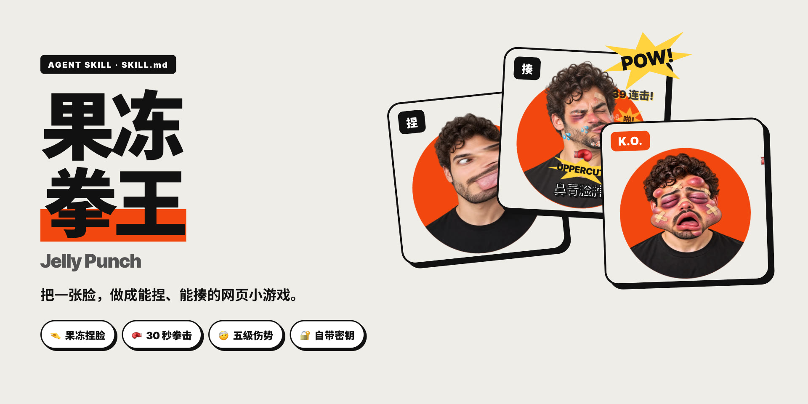
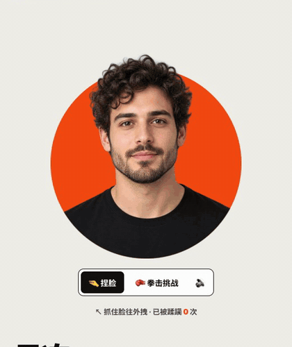
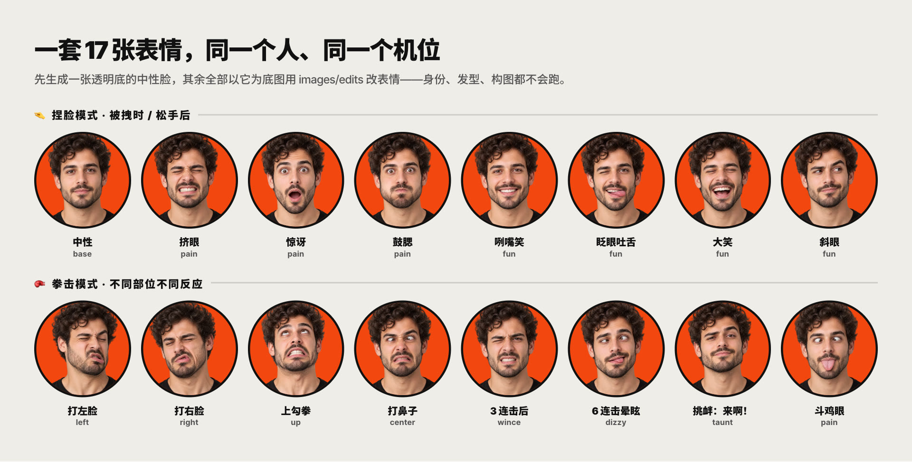
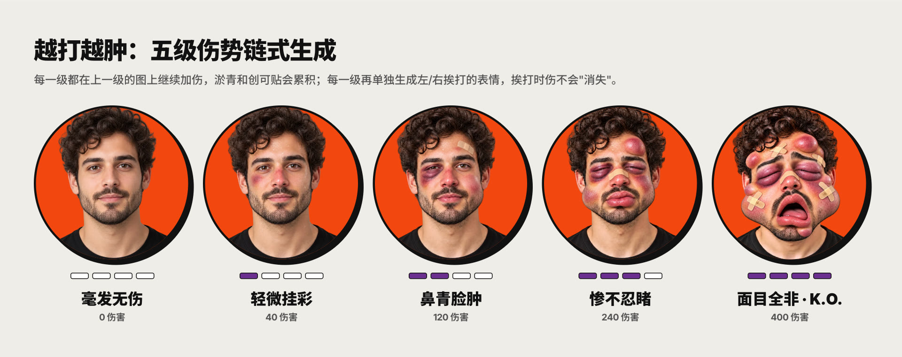
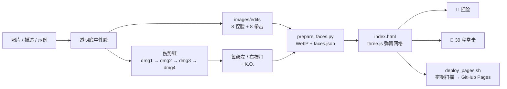

<p align="center">
  
</p>

<p align="center">
  <a href="https://github.com/Mr-funny/hbg-jelly-face-site/actions/workflows/ci.yml"></a>
  
  
  
  
  
  
</p>

<p align="center">
  把一张脸，做成<strong>能捏、能揍的网页小游戏</strong>。<br />
  <strong>果冻捏脸 · 30 秒拳击挑战 · 左右脸 / 下巴 / 鼻子不同反应 · 五级伤势越打越肿 · 一键发布 GitHub Pages</strong>
</p>

<p align="center">
  <a href="https://mr-funny.github.io/jelly-face/"><strong>🎮 在线试玩 →</strong></a>
</p>

> 这不是"一张图加个抖动滤镜"。脸是一张 60×55 的弹簧网格，可以被拽成太妃糖、被拳头打歪再弹回来。表情不是贴图叠加：一个人的 30 张图全部从同一张中性脸用图像编辑接口改出来，所以换表情、加伤势时，人、发型和机位都不会变。

<p align="center">
  
</p>

## ⚡ 一句话安装进 Agent

把下面整段话发给 Claude Code、Codex 或其他支持 `SKILL.md` 的 Agent：

```text
请从 https://github.com/Mr-funny/hbg-jelly-face-site 安装 hbg-jelly-face-site skill。

请自动识别当前 Agent 的全局 skills 目录；如果已经存在旧版本，请先备份再更新。
安装后检查 SKILL.md、agents、references、scripts 和 template 是否完整，
运行 shell 语法检查、Python 编译检查和 tools/validate_skill.py。
不要读取、打印或上传任何 API Key、.env、照片或生成素材。

验证完成后，告诉我如何使用 $hbg-jelly-face-site
把我自己的照片做成一个能捏、能揍的网页小游戏。
```

安装后直接说：

```text
使用 $hbg-jelly-face-site，用 ~/Desktop/me.jpg 这张我本人的照片
生成全套表情和五级伤势，做成果冻拳王小游戏。
先给我看一张预览图，我确认后再发布到 GitHub Pages，仓库叫 punch-me。
```

## 🎯 它解决的不是"脸会动"，而是"脸动得像真的、还不崩"

| 常见问题 | Skill 的处理方式 |
|---|---|
| 拖拽只是整张图平移或缩放 | 60×55 网格 + 弹簧软体：抓住的点跟手，周围按高斯衰减，拉出"太妃糖丝"，松手过冲回弹 |
| 身体被拽出圆盘，露出裁切边 | 按网格**静止位置**在 shader 里裁身体，皮肤被拉走时切口跟着走 |
| 每张表情 AI 都换了一个人 | 先出透明底中性脸，其余全部用 images/edits 以它为底图改，身份、发型、构图都锁住 |
| 伤势一挨打就"消失" | 伤势链式生成（每级在上一级上加伤），每级再单独生成左 / 右挨打表情 |
| 连击太快把脸打碎 | 冲量叠加有上限（`MAX_KNOCK`），出拳有冷却，连击加成封顶 |
| 只会一直点同一个地方 | 换部位 +1 伤害，连击每 15 下 +1（最多 +2），10% 暴击；鼓励打不同位置 |
| 特效糊在脸上看不清 | 爆炸字偏到出拳一侧，伤势提示放在衣服上，连击数原地刷新不堆叠 |
| 密钥被写进脚本、页面或 git | 只读环境变量 / `.env`；`curl -K -` 走标准输入；发布前和 CI 都做密钥扫描 |
| 页面依赖在线生图，打开就扣费 | 运行时**零 API 调用**：所有图提前生成成静态 WebP，GitHub Pages 直接托管 |

## ✨ 核心能力

| 模块 | 能力 |
|---|---|
| 捏脸模式 | 任意位置拖拽拉长；被拽时换"痛苦"表情，松手换"调皮"表情；轻点会抖一下 |
| 拳击挑战 | 30 秒限时；3-2-1 倒计时 + 铃声；击中数、计时条、伤势条实时更新 |
| 部位判定 | 左脸颊、右脸颊、下巴（上勾拳）、鼻子 / 额头，头往不同方向甩、表情不同 |
| 连击系统 | 650ms 内算连击；3 连流汗、6 连晕眩转星星、暴击白闪 + 更大震屏 |
| 五级伤势 | 毫发无伤 → 轻微挂彩 → 鼻青脸肿 → 惨不忍睹 → 面目全非，打满 K.O. 瘫倒 |
| 结算 | 总击打、最高连击、伤势、称号（挠痒痒选手 → 人形打桩机）、本机最佳纪录 |
| 手感细节 | 拳套光标、漫画爆炸字、屏幕震动、Web Audio 实时合成音效（可静音） |
| 角色来源 | 示例角色 / 自己的照片 / 一句话描述 / 自带表情图，四选一 |
| 图像接口 | 任意 OpenAI 兼容的 `images/generations` + `images/edits`，自带密钥 |
| 发布 | `deploy_pages.sh` 建仓库、推送、开 Pages，发布前扫描密钥 |

## 🖼️ 一个角色，30 张图

<p align="center">
  
</p>

<p align="center">
  
</p>

示例角色是 AI 生成的虚构人物，全套 30 张图随 skill 一起提供，安装后不需要任何密钥就能先玩起来。

## 🚀 快速开始

### 方法一：让 Agent 自动安装（推荐）

复制上面的"一句话安装"提示，让 Agent 完成下载、备份、安装和验证。

### 方法二：安装到 Claude Code

```bash
curl -fsSL https://raw.githubusercontent.com/Mr-funny/hbg-jelly-face-site/main/install.sh | sh
```

默认安装到 `~/.claude/skills/hbg-jelly-face-site`。

### 方法三：安装到 Codex

```bash
curl -fsSL https://raw.githubusercontent.com/Mr-funny/hbg-jelly-face-site/main/install.sh | sh -s -- --codex
```

### 方法四：手动安装

```bash
git clone https://github.com/Mr-funny/hbg-jelly-face-site.git
mkdir -p ~/.claude/skills/hbg-jelly-face-site
cp -R hbg-jelly-face-site/skill/hbg-jelly-face-site/. ~/.claude/skills/hbg-jelly-face-site/
```

### 不用 Agent，直接跑

```bash
S=~/.claude/skills/hbg-jelly-face-site
bash $S/scripts/new_site.sh my-game --demo        # 带上示例角色
python3 -m http.server 8801 --directory my-game   # 打开 http://localhost:8801
```

依赖：`python3`、`ffmpeg`、`curl`；发布需要已登录的 [`gh`](https://cli.github.com/)。

## 🔑 配置你自己的图像接口

只有"用照片 / 描述生成角色"才需要密钥。任何 OpenAI 兼容服务都可以：

```bash
mkdir -p ~/.config/hbg-jelly-face
cat > ~/.config/hbg-jelly-face/.env <<'EOF'
JELLY_API_KEY=你的密钥
JELLY_API_BASE=https://api.openai.com/v1
JELLY_IMAGE_MODEL=gpt-image-1
EOF
chmod 600 ~/.config/hbg-jelly-face/.env
```

| 变量 | 说明 | 默认 |
|---|---|---|
| `JELLY_API_KEY` | 接口密钥 | — |
| `JELLY_API_BASE` | 接口地址（以 `/v1` 结尾） | `https://api.openai.com/v1` |
| `JELLY_IMAGE_MODEL` | 需支持 `background=transparent` | `gpt-image-1` |

读取顺序：环境变量 → `<站点>/.env` → `~/.config/hbg-jelly-face/.env`。详见 [api-config.md](skill/hbg-jelly-face-site/references/api-config.md)。

## 🧑 换成你自己的脸

```bash
S=~/.claude/skills/hbg-jelly-face-site
bash $S/scripts/new_site.sh punch-me
bash $S/scripts/gen_faces.sh punch-me --photo ~/Desktop/me.jpg --set all   # 约 30 张，5–8 分钟
python3 -m http.server 8801 --directory punch-me                          # 先本地玩一把
bash $S/scripts/deploy_pages.sh punch-me punch-me                         # 发布到 GitHub Pages
```

- 照片要求：正脸、光线均匀、露出头和肩膀，不需要自己抠图。
- 生成完先看 `punch-me/raw/`。哪张走样就删掉，再用 `--skip-base --expressions <名字>` 单独重生。
- 已经有一套表情图？跳过生成，直接导入：

  ```bash
  python3 $S/scripts/prepare_faces.py punch-me base=neutral.png grin=smile.png hit_left=ouch.png ...
  ```

`--set` 可选 `pinch`（8 种捏脸表情）、`boxing`（8 种拳击反应）、`damage`（四级伤势 × 3 + K.O.）、`all`。

## 🤖 使用示例

### 用示例角色快速上线

```text
使用 $hbg-jelly-face-site 用示例角色做一个果冻拳王，
游戏名改成"打工人解压馆"，主色换成蓝色，发布到 GitHub Pages。
```

### 用一句话描述生成虚构角色

```text
使用 $hbg-jelly-face-site 生成一个虚构角色：
戴黑框眼镜、穿格子衬衫、头发很乱的程序员。全套表情和伤势都要，先给我看预览。
```

### 调手感

```text
使用 $hbg-jelly-face-site 把拳击回合改成 20 秒，伤势升级再难一点，
捏脸时拉得更细更长，回弹多抖几下。
```

## 🧠 工作原理



四条原则：

1. **所有图来自同一张底图。** 不靠"同一段提示词"，靠以图改图锁住身份和机位。
2. **伤势只累积、不重来。** 每一级都以上一级为底图，淤青和创可贴不会凭空换位置。
3. **物理有上限。** 拉扯可以夸张，挨打要有分寸：冲量、偏移、连击加成全部封顶。
4. **发布物里只有静态文件。** 页面不调接口，密钥永远停在本机。

## 🎛️ 可调参数

全部集中在 `index.html` 脚本开头。完整说明见 [tuning.md](skill/hbg-jelly-face-site/references/tuning.md)。

| 参数 | 默认 | 作用 |
|---|---|---|
| `SIGMA` | 0.065 | 抓取半径：小 = 太妃糖丝，大 = 拽面团 |
| `K_REST` / `COUPLE` | 220 / 700 | 回弹硬度 / 表面连带 |
| `ROUND_S` | 30 | 拳击回合秒数 |
| `STAGE_DMG` | 0, 40, 120, 240, 400 | 五级伤势门槛 |
| `COMBO_MS` | 650 | 连击判定窗口 |
| `MAX_KNOCK` | 0.1 | 挨打最大形变 |

## 📁 仓库结构

```text
skill/hbg-jelly-face-site/   Agent Skill 本体
  ├─ SKILL.md                工作流程与规则
  ├─ scripts/                new_site / gen_faces / prepare_faces / deploy_pages
  ├─ references/             api-config / tuning / quality-gate
  └─ template/               index.html + 示例角色 30 张图
docs/showcase/               README 视觉预览（由实际游戏录屏生成）
examples/                    提示词示例
tools/                       CI 结构校验与密钥扫描
install.sh                   Claude Code / Codex 安装器
```

## 🔐 隐私与合规

- 不提交 API Key、`.env`、`raw/` 原图或任何 GitHub token；CI 会扫描长十六进制串、`sk-`、`Bearer` 和本机路径。
- **只用你自己的脸，或明确同意的人的脸。** 拳击模式会把脸打成鼻青脸肿，拿别人的照片就是在羞辱别人。
- 伤势只做喜剧效果（淤青、肿包、创可贴），提示词里明确不出血、不出伤口。
- 发布到 GitHub Pages 的页面任何人都能看到，包括你的照片和所有伤势图。

## 📄 License

MIT License。示例角色为 AI 生成的虚构人物，与任何真人无关。

欢迎提交 Issue 和 PR：新的表情提示词、更准的部位判定、新的游戏模式，都很欢迎。
